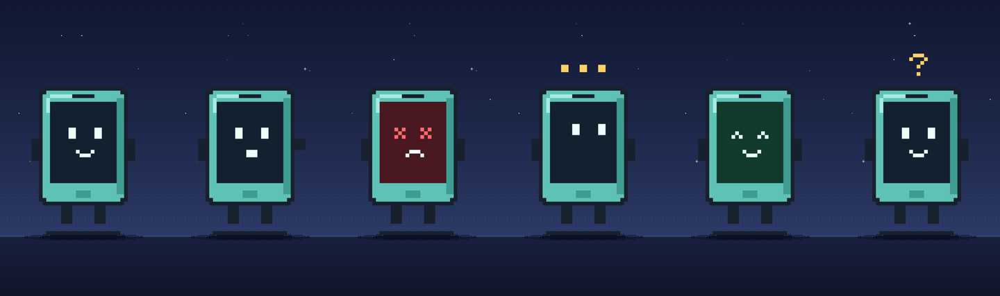

# facetime-me

**FaceTime your coding agent.** A pixel mascot answers on a real Apple line, talks back with
OpenAI Realtime, and shows what it's doing on its screen. Optionally it also **calls you** when
Claude Code hits a failing command or is stuck waiting on you, and fixes the problem if you say yes.



## Set up (about 5 minutes)

You need macOS or Linux, **Node 20+**, an iPhone/iPad/Mac with FaceTime and iMessage, a free
[LiveKit Cloud](https://cloud.livekit.io) project, and an [OpenAI API key](https://platform.openai.com/api-keys).

```bash
git clone https://github.com/ysta32/facetime-me && cd facetime-me && npm run setup
```

That one command walks you through everything and can be re-run any time (finished steps are skipped):

1. installs dependencies, including the [Chert](https://www.trychert.com) CLI
2. opens Chert in your browser: sign in, enter your phone, text the code it shows **over iMessage**.
   Chert gives you a FaceTime line (free trial: 50 minutes over 24 hours)
3. asks for your LiveKit and OpenAI keys. They're typed hidden and saved only to `.env.local` (mode 600)
4. runs `chert doctor` to check the line, keys and model
5. *optional:* adds Claude Code hooks so the mascot calls **you**
6. puts a `facetime-me` command on your PATH

Then, in any terminal:

```bash
facetime-me --listen
```

and FaceTime the number it prints. Ctrl+C frees the line.

## Commands

| Command | What it does |
| --- | --- |
| `facetime-me --setup` | The setup above. Re-run it to change keys or add the alert hooks |
| `facetime-me --listen` | Answer FaceTime calls until Ctrl+C. One listener at a time |
| `facetime-me --demo` | A scripted, recordable demo: a build fails, it calls you, fixes it on the call |
| `facetime-me --on` / `--off` / `--status` | Pause or resume the "call me when something breaks" alerts |

## How it works

```
your iPhone ──FaceTime──▶ Chert's Mac ──LiveKit room──▶ agent.mjs (this repo, on your machine)
                                                         ├─ voice: OpenAI Realtime
                                                         └─ camera: mascot.mjs + scene.mjs, 720×1280 @ 30 fps
```

- `chert dev` (started by `--listen`) connects your Chert line to the LiveKit agent `claude-code-facetime`.
- **Alerts** (optional): `bin/facetime-me.mjs` is also a Claude Code hook for `PostToolUseFailure`,
  `StopFailure` and `Notification`. On a real problem it places an outbound call (`place-call.mjs`),
  explains what broke, and if you say "yes, fix it" runs a headless `claude -p` fork of your session
  while the mascot mirrors its live tool calls (`activity.mjs`). There's a 10-minute cooldown and it never
  calls twice about the same error. Outbound calls need a Chert project API key (setup asks for it).

## Using your own mascot art

The repo ships an original mascot drawn in code (`buddy.mjs`). If you have a GIF pack laid out as
`manifest.json` plus `<state>.gif` files (see `STATES` in `bake.mjs`), point `FACETIME_ME_MASCOT_DIR` at it.
It's baked into local, git-ignored frames. Only use art you have the rights to; see [NOTICE.md](NOTICE.md).
Baking needs `ffmpeg`. Force the built-in one with `FACETIME_ME_MASCOT=buddy`.

## Costs and limits

- **Chert:** the free trial is 50 FaceTime minutes over 24 hours, 5 minutes per call. Shared is $25/month
  ([billing](https://app.trychert.com/billing)). The CLI never buys anything.
- **OpenAI Realtime** is billed per minute of audio by OpenAI. **LiveKit Cloud** has a free tier.

## Troubleshooting

- `chert doctor` checks sign-in, line, Mac, LiveKit and OpenAI. `chert guide fix` explains every error code.
- **"Which project would you like to use?"** in the browser: you have several Chert projects. Run
  `facetime-me --setup` again; it names the project for you.
- **Call connects but it's silent:** that's Chert-side audio on the line's Mac. Report it with the call time.
- Logs: `state/agent-listen.log`, `state/chert-dev-listen.log`, `state/facetime-me.log`.

## License

MIT for the code and the built-in mascot. Unofficial, and not affiliated with Anthropic or Apple. See [NOTICE.md](NOTICE.md).
